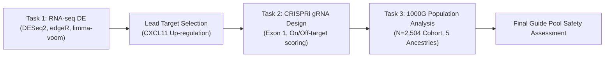

# IFN646: Computational Genomics & CRISPR Pipeline for COVID-19 Target Discovery

This repository contains an end-to-end computational pipeline developed for the **IFN646 Biomedical Data Science** project. The project identifies host transcriptional dysregulation in COVID-19, designs targeted CRISPR interference (CRISPRi) guide RNAs against the lead target gene (*CXCL11*), and evaluates on-target and off-target safety across a global human cohort ($N = 2,504$) using 1000 Genomes Project Phase 3 data.

---

## Pipeline Overview



1. **Task 1 — Differential Expression Analysis:** Consensus analysis across three statistical frameworks (DESeq2, edgeR LRT/QL, and limma-voom) on SARS-CoV-2 infected airway epithelial cells (GSE159717, 5 dpi) to identify consensus differentially expressed genes.
2. **Task 2 — CRISPRi Guide RNA Design (*CXCL11*):** Extraction of the non-overlapping first exon of *CXCL11* on Chromosome 4, candidate protospacer identification, and on-target/off-target efficacy scoring (Doench 2016, MIT, and CFD) via CRISPOR. All 9 eligible guide RNAs are ranked without artificial pool truncation.
3. **Task 3 — Population-Scale Variant & Off-Target Analysis ($N = 2,504$):** Evaluation of natural genetic variation across 26 global populations (AFR, AMR, EAS, EUR, SAS) at the on-target locus and 2,928 predicted off-target sites. Quantifies PAM disruption, seed-region mismatches, haplotype phasing, and ancestry-specific risk alleles.

---

## Repository Structure

```
├── data/                                # Input datasets and reference data
│   ├── gse159717_rnaseq_deseq_5dpi_counts_raw.tsv  # RNA-seq count matrix
│   ├── metadata.csv                     # RNA-seq sample condition metadata
│   ├── crispor_cxcl11_results.xls       # CRISPOR guide predictions for CXCL11
│   ├── task3_offtarget_regions.bed      # 2,928 CRISPOR off-target genomic coordinates
│   ├── n2504/                           # 1000 Genomes sample metadata and IDs
│   │   ├── sample_ids.txt
│   │   └── sample_metadata.tsv
│   ├── vcfs/
│   │   └── n2504/                       # 1000 Genomes N=2,504 regional normalized VCFs
│   │       ├── sampled_chr4.norm.vcf.gz.csi
│   │       └── sampled_chr4.norm.vcf.gz.n2504_regions_complete
│   └── GRCh38.fa.fai                    # Reference FASTA index
├── notebooks/
│   ├── 02_grna_cxcl11_crispri.ipynb     # Task 2: gRNA design and scoring
│   └── 03_variant_analysis_cxcl11_n2504_genome_wide-KM.ipynb # Task 3: Population variant analysis
├── scripts/
│   └── 01_rnaseq_de_analysis.R          # Task 1: R script for DE consensus pipeline
├── utils/
│   ├── download_large_files.sh          # Downloader for large external reference assets
│   ├── setup_task3.sh                   # Comprehensive environment and data prep for Task 3
│   ├── task2_utils.py                   # Helper functions for Task 2 analysis and tables
│   ├── variant_utils.py                 # Core analysis engine for Task 3 VCF parsing & scoring
│   ├── prepare_n2504_vcfs.py            # Remote indexed VCF extractor from 1000G EBI FTP
│   ├── prepare_grch38.py                # Reference genome download, MD5 check & indexing
│   └── test_variant_utils.py            # Automated test suite (48 unit tests)
└── results/
    ├── tables/                          # Output CSV/TSV tables for Tasks 1, 2, and 3
    └── figures/                         # High-resolution publication plots (PDF, PNG)
```

---

## Environment Setup

### 1. Prerequisites
- **Linux / macOS** (x86_64 or ARM64)
- **Python 3.10+** (recommended: Conda / Mamba)
- **R 4.2+** with Bioconductor
- CLI Tools: `samtools` and `bcftools`

### 2. Conda Environment
```bash
conda create -n ifn646 python=3.10 -y
conda activate ifn646

# Install bioinformatics tools and Python packages
conda install -c bioconda -c conda-forge bcftools samtools pysam -y
pip install pandas numpy matplotlib seaborn scipy openpyxl jupyter
```

### 3. R Dependencies (Task 1)
In R:
```R
if (!requireNamespace("BiocManager", quietly = TRUE))
    install.packages("BiocManager")

BiocManager::install(c("DESeq2", "edgeR", "limma", "pheatmap"))
install.packages(c("tidyverse", "VennDiagram", "RColorBrewer"))
```

---

## Data Download & Preparation

Large reference files (`GRCh38.fa` ~3.1 GB and 1000 Genomes VCFs) are not tracked in Git. Run the automated download script:

```bash
bash utils/download_large_files.sh
```

This script:
1. Downloads `GCF_000001405.26_GRCh38_genomic.fna.gz` from NCBI (if missing).
2. Decompresses it to `data/GRCh38.fa` and builds `data/GRCh38.fa.fai` using `samtools faidx`.
3. Verifies or generates the Chromosome 4 regional VCF (`data/vcfs/n2504/sampled_chr4.norm.vcf.gz`).
4. Automatically skips any asset already present and valid.

---

## How to Run

### Task 1: RNA-seq Differential Expression Analysis

Execute the complete multi-method consensus analysis:

```bash
Rscript scripts/01_rnaseq_de_analysis.R
```

- **Inputs:** `data/gse159717_rnaseq_deseq_5dpi_counts_raw.tsv`, `data/metadata.csv`
- **Outputs:**
  - `results/tables/`: Consensus DE tables, method-specific log2FC and FDR summaries.
  - `results/figures/`: PCA plots, volcano plots, MA plots, expression heatmaps, and Venn diagrams.
- **Key Finding:** *CXCL11* is confirmed as a robust consensus up-regulated chemokine in SARS-CoV-2 infection, selecting it for CRISPRi repression.

---

### Task 2: CRISPRi Guide RNA Design for *CXCL11*

Open and run the Jupyter notebook:

```bash
jupyter notebook notebooks/02_grna_cxcl11_crispri.ipynb
```

- **Inputs:** `data/crispor_cxcl11_results.xls`, `data/cxcl11_first_exon_plus_25bp.fa`
- **Outputs:**
  - `results/tables/task2_cxcl11_crispri_final_pool.csv` (All 9 eligible guides targeting Exon 1)
  - `results/tables/task2_cxcl11_crispri_full_pool.csv`
  - `results/figures/task2_*.png` (Efficiency vs. specificity distributions, Exon 1 positioning map)
- **Key Finding:** All 9 eligible guides achieve high on-target activity (Doench 2016 score > 50) and zero off-targets with ≤2 mismatches.

---

### Task 3: Population-Scale Variant Analysis ($N = 2,504$)

#### Step 1: Run the Task 3 Setup Script
Prepare the reference genome, regional VCFs, and run unit tests:

```bash
bash utils/setup_task3.sh
```

*(Optional: to extract all 22 autosomes for genome-wide off-target analysis, add `--all-autosomes`)*.

#### Step 2: Run the Task 3 Notebook
Launch and execute the notebook end-to-end:

```bash
jupyter notebook notebooks/03_variant_analysis_cxcl11_n2504_genome_wide-KM.ipynb
```

- **Inputs:**
  - `data/GRCh38.fa` (Reference genome)
  - `data/task3_offtarget_regions.bed` (Off-target coordinates)
  - `data/n2504/sample_metadata.tsv` (1000G population annotations)
  - `data/vcfs/n2504/sampled_chr4.norm.vcf.gz` (Cohort variants)
- **Outputs:**
  - `results/tables/n2504_cxcl11/`: On-target variant catalogs, PAM disruption events, off-target risk scores, and ancestry-stratified allele frequencies.
  - `results/figures/n2504_cxcl11/`: PAM disruption frequencies across 5 ancestries, allele frequency heatmaps, and off-target risk distributions.
